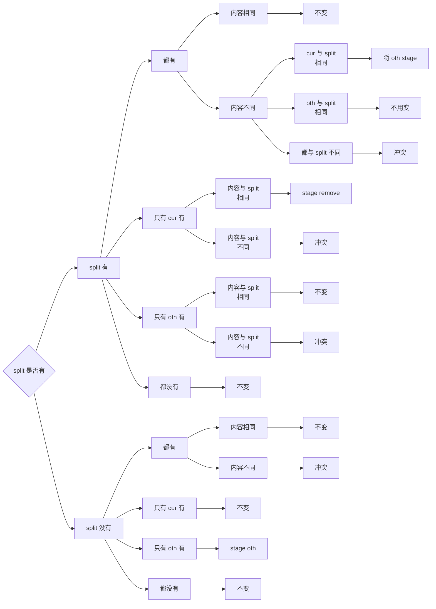

# CS61B-Project2: Gitlet

## 背景介绍

Git 是一款分布式版本控制系统，最初由 Linus Torvalds 开发，用于管理 Linux 内核代码。Git 具有高效、灵活、分布式等特点，广泛应用于软件开发中。

在这个 Project 中，我们要**实现 git 的简化版——Gitlet**。它支持最基本的**版本控制，分支管理以及远程仓库**的相关命令。在这个过程中，我们不仅能从实现的角度加深对 Git 的理解，还能锻炼我们对数据结构和算法的掌握。

---

## 需求分析

我们要在 `gitlet` 目录中实现我们的 Gitlet 系统，具体包括以下指令。

### init

```bash
java gitlet.Main init
```

该指令负责初始化 Gitlet 仓库，它会创建 `.gitlet` 目录，未来所有的 Gitlet 数据都会存储在该目录下。

在创建的同时还会进行一个空的 commit，commit 的 message 为 `initial commit`，时间戳为 `00:00:00 UTC, Thursday, 1 January 1970`。初始分支为 `master`，并且 `HEAD` 指向 `master` 分支。

- 如果 `.gitlet` 目录已经存在，则输出 `A Gitlet version-control system already exists in the current directory.`

### add

```bash
java gitlet.Main add <filename>
```

- `filename`：需要 add 的文件名

该指令将指定的文件加入到暂存区中，**一次一个**，文件的状态可能有以下几种情况：

- **未跟踪**：即在当前 commit 和暂存区中都不存在的文件，应当将其加入暂存区。
- **已跟踪**：即在当前 commit 中存在的文件，应当将其加入暂存区。
- **已暂存**：当前文件已经在暂存区中，应当**重新加入**将原有的暂存状态覆盖。
- **已 remove**：文件在暂存区中被标记为 remove 状态，应当取消该状态并将其加入暂存区。

**注意：**如果 add 过后，文件在暂存区的**内容与当前 commit 一致**，相当于没做任何改动，此时应当取消该文件的暂存状态。

- 若文件不存在，则输出 `File does not exist.`

### commit

```bash
java gitlet.Main commit <message>
```

- `message`：commit 的 message 信息

执行一次提交（commit）操作，生成一个新的 commit 对象，将暂存区中记录的更新保存到新的 commit 中，并**清空暂存区**。

一次 commit 应当包含如下图所示的信息：


- 时间戳：commit 时的当前时间。
- message：传入的 message。
- commit id：commit 对象的 SHA-1 值。
- parent：其父 commit 的 id。
- blob：当前 commit 中所有文件副本的 SHA-1 值。

这里简单介绍一下 SHA-1。其原名是 Secure Hash Algorithm 1，是一种加密哈希函数。SHA-1 可以**将任意长度的字节流转化为 160 位的哈希值**。

SHA-1 的特点是两个不同的字节流计算出相同的 SHA-1 值的概率约为 $2^{-160}$，因此可以作为该字节流的**唯一标识**。

在官方为我们提供的 `gitlet/Utils.java` 中，我们可以使用 `sha1()` 方法来计算一个字符串或字节数组的 SHA-1 值。可以通过 `serialize()` 方法将一个对象序列化为字节数组，然后再使用 `sha1()` 方法计算其 SHA-1 值。

通过 `sha1(serialize(commit))` 计算出的 SHA-1 值就是该 commit 的 id，同时也是其在 `.gitlet` 目录中存储的文件名。

- 如果暂存区为空，则输出 `No changes added to the commit.`
- 如果 message 为空，则输出 `Please enter a commit message.`

commit 的 id 为 commit 对象的 SHA-1 值，将 commit 对象序列化后存储在 `.gitlet/commits` 目录下，文件名为 commit 的 id。

### rm

```bash
java gitlet.Main rm <filename>
```

- `filename`：需要 remove 的文件名

该指令用于删除文件或解除对文件的暂存或跟踪状态。

如果该文件在**暂存区**，则取消其暂存状态，不做其它改变。

如果文件在**当前 commit**中，则将其标记为 remove 状态，并从工作区中**删除该文件**。

- 如果文件既不在暂存区中也不在当前 commit 中，则输出 `No reason to remove the file.`

### log

```bash
java gitlet.Main log
```

该指令用于打印当前 commit 的历史信息

`log` 会从当前 `HEAD` 指向的 commit 开始，沿着 firstParent 指针一直向上遍历，按照如下格式输出每一个 commit 的信息，直到遍历到初始 commit 为止。

```bash
===
commit 3e8bf1d794ca2e9ef8a4007275acf3751c7170ff
Date: Thu Nov 9 17:01:33 2017 -0800
Another commit message.

===
commit e881c9575d180a215d1a636545b8fd9abfb1d2bb
Date: Wed Dec 31 16:00:00 1969 -0800
initial commit
```

信息包括 commit 的 SHA-1 值，commit 的时间戳，commit 的 message。

如果该 commit 来自于 merge，则会输出两个 parent 的 SHA-1 值的前 7 位：

```bash
===
commit 3e8bf1d794ca2e9ef8a4007275acf3751c7170ff
Merge: 4975af1 2c1ead1
Date: Sat Nov 11 12:30:00 2017 -0800
Merged development into master.
```

### global-log

```bash
java gitlet.Main global-log
```

该指令会直接输出所有 commit 的信息，没有指定顺序，格式和 log 一样。

### find

```bash
java gitlet.Main find <message>
```

- `message`：需要查找的 commit message

该指令负责查找 message 与指定字符串相同的 commit，并输出其 SHA-1 值，支持查找多个这样的 commit，每行一个。

- 如果没有找到，则输出 `Found no commit with that message.`

### status

```bash
java gitlet.Main status
```

该指令用于查询当前 Gitlet 仓库的状态，以下是一个输出示例

```bash
=== Branches ===
*master
other-branch
  
=== Staged Files ===
wug.txt
wug2.txt
  
=== Removed Files ===
goodbye.txt
  
=== Modifications Not Staged For Commit ===
junk.txt (deleted)
wug3.txt (modified)
  
=== Untracked Files ===
random.stuff
```

首先会输出仓库中的所有分支，当前 `HEAD` 所在的分支会在前面加上 `*`，其他分支按**字典序**排列。

第二部分是暂存区中已经 add 的文件列表，按**字典序**排列。

第三部分是暂存区中已经 remove 的文件列表，按**字典序**排列。

第四部分是工作区相较于当前 commit 或暂存区已经做出修改但还未暂存的文件列表，按**字典序**排列。要求标注该文件所作的修改类型，包括 modified 和 deleted。

第五部分是工作区中未跟踪的文件列表，按**字典序**排列，即不在暂存区又不在当前 commit 的文件就是未跟踪文件。

**注意：**每一部分之间都有一个空行

### checkout

checkout 根据参数的不同有三种使用方法：

#### checkout -- [file name]

```bash
java gitlet.Main checkout -- [file name]
```

- `file name`：需要恢复的文件名.

该命令将指定的文件**恢复到当前 commit 中的状态**。

- 如果该文件在当前 commit 中不存在，则输出 `File does not exist in that commit.`

#### checkout [commit id] -- [file name]

```bash
java gitlet.Main checkout [commit id] -- [file name]
```

- `commit id`：需要恢复的 commit id
- `file name`：需要恢复的文件名

和上一个类似都是恢复指定文件，但上一个是恢复到**当前 commit** 的状态，而这个是恢复到**指定 commit** 的状态。

**注意：**指定的 commit id 可以是完整的 SHA-1 值，**也可以是完整的 SHA-1 值的前若干位**。

- 如果该 commit 不存在，则输出 `No commit with that id exists.`。
- 如果该文件在指定 commit 中不存在，则输出 `File does not exist in that commit.`

#### checkout [branch name]

```bash
java gitlet.Main checkout [branch name]
```

该指令用于分支切换，会将 `HEAD` 指针指向指定的分支，同时会清空暂存区，并将工作区**恢复到新分支的状态**。

具体来讲，它会删除在当前分支中跟踪但在新分支中不存在的文件，并将新分支中跟踪的文件覆盖到工作区中。

- 如果该分支不存在，则输出 `No such branch exists.`。
- 如果该分支就是当前分支，则输出 `No need to checkout the current branch.`。
- 如果切换分支会导致工作区中未跟踪文件被覆盖，则输出 `There is an untracked file in the way; delete it, or add and commit it first.`

### branch

```bash
java gitlet.Main branch <branch name>
```

- `branch name`：需要创建的分支名

该指令负责创建一个新的分支，新分支将指向当前 commit，分支名为`branch name`。

该命令**不会修改 `HEAD` 指针**。

- 如果该分支已经存在，则输出 `A branch with that name already exists.`。

### rm-branch

```bash
java gitlet.Main rm-branch <branch name>
```

- `branch name`：需要删除的分支名

该命令负责删除名为 `branch name` 的分支。注意只是删除分支的指针，并**不会**删除分支对应的 commit 记录和文件副本。

- 如果该分支不存在，则输出 `A branch with that name does not exist.`。
- 如果该分支就是当前分支，则输出 `Cannot remove the current branch.`

### reset

```bash
java gitlet.Main reset <commit id>
```

- `commit id`：需要重置到的 commit id

该指令会将当前的工作状态重置到 commit id 对应的 commit 中的状态。相当于 checkout 指定 commit 中的所有文件，并且会删除在当前 commit 中但不在指定 commit 中的文件。

此外，该指令还会将**当前分支的头指针以及 `HEAD`** 指针指向该 commit。

- 如果该 commit 不存在，则输出 `No commit with that id exists.`。
- 如果重置会导致工作区中未跟踪文件被覆盖，则输出 `There is an untracked file in the way; delete it, or add and commit it first.`

### merge

```bash
java gitlet.Main merge <branch name>
```

- `branch name`：需要合并的分支名

#### 功能描述

该指令负责将 `branch name` 对应的分支合并到当前分支中，**要求当前暂存区为空**。

在合并过程中，首先要找到两个分支的**最近共同祖先**，其定义为：该 commit 是两个分支当前 commit 的共同祖先，但同时它不是任意一个共同祖先的祖先。

概念可能比较绕，可以参考下面这张图，其中蓝色箭头所指向的就是这两个分支的最近共同祖先，也叫做 split point。


**需要注意**，一个 commit 的 secondParent 指向的 commit 同样是它的祖先，因此这时的整个 commit 树实际上是一个有向无环图（DAG），而不是一棵树。

如果 split point 就是**给定分支**所指向的 commit，那么就什么也不做，输出 `Given branch is an ancestor of the current branch.`

如果 split point 就是**当前分支**所指向的 commit，那么我们就 checkout 到指定分支，并输出 `Current branch fast-forwarded.`

如果这三个 commit 各不相同，我们需要综合文件在当前分支和给定分支中相较于 split point 的状态来决定该文件是**保持现状、移除、覆盖，还是冲突**。

在这里面，**冲突**的意思是：当前分支和给定分支都对该文件做了修改，并且修改的内容不一样。（修改既包括内容变更，也包括删除。）

发生冲突时，我们要直接将以下信息写入到冲突文件中：

```txt
<<<<<<< HEAD
contents of file in current branch
=======
contents of file in given branch
>>>>>>>
```

其中 `contents of file..` 分别是对应分支该文件的内容，如果某个分支删除了该文件，这部分为空。

判断一个文件要如何处理的逻辑相当复杂，因此我用流程图的形式来进行展示，如下图所示。其中 split 代表共同祖先， cur 代表当前分支，oth 代表给定分支。



最后我们还要创建一个新的 commit 来记录这次合并，commit 的 firstParent 为当前 commit，secondParent 为给定 commit，message 为 `Merged <branch name> into <current branch name>.`。

如果合并过程中遇到了冲突，我们要在**终端**中输出 `Encountered a merge conflict.`

- 如果暂存区中存在未提交的修改，则输出 `You have uncommitted changes.`
- 如果该分支不存在，则输出 `A branch with that name does not exist.`
- 如果该分支就是当前分支，则输出 `Cannot merge a branch with itself.`
- 如果合并会导致工作区中未跟踪文件被覆盖，则输出 `There is an untracked file in the way; delete it, or add and commit it first.`


### add-remote

```bash
java gitlet.Main add-remote <remote name> <name of remote directory>/.gitlet
```

- `remote name`：远程仓库的名字
- `name of remote directory`：远程仓库的所在目录

该指令负责添加一个远程仓库，远程仓库的名字为 `remote name`，所在目录为 `name of remote directory`，对应的 `.gitlet` 目录即为 `name of remote directory/.gitlet`。

未来进行 push，fetch 等操作时，都会使用该远程仓库的名字来进行操作。

**注意**：该指令并不会检查该远程仓库是否存在。

- 如果该名字的远程仓库已经添加，则输出 `A remote with that name already exists.`

### rm-remote

```bash
java gitlet.Main rm-remote <remote name>
```

- `remote name`：要删除的远程仓库的名字

该指令与 `add-remote` 相对，负责删除名字为 `remote name` 的远程仓库。注意只是删除远程仓库的名字，并**不会**删除远程仓库的实际内容。

- 如果该名字不存在，则输出 `A remote with that name does not exist.`

### push

```bash
java gitlet.Main push <remote name> <remote branch name>
```

- `remote name`：要推送的远程仓库的名字
- `remote branch name`：要推送的远程分支名字

该指令会将本地仓库的**当前 commit 及该 commit 的所有父 commit** 全部复制到远程仓库的指定分支下，本地仓库中不是当前 commit 的祖先的 commit 不会被推送。

推送完成后，该指令还会将远程仓库的 **`HEAD` 指针以及对应的分支指针**指向当前 commit，同时工作目录里的内容也恢复到当前 commit，相当于 reset 操作。如果指定的分支不存在，会创建该分支。

如果远程仓库的指定分支存在，我们要求该分支所在的 commit **必须是当前 commit 的祖先**，即本地仓库应当有该分支的所有 commit 记录并且有更新的内容。

- 如果远程仓库对应分支的 commit 不是当前 commit 的祖先，输出 `Please pull down remote changes before pushing.`

- 如果远程仓库的 `.gitlet` 不存在，则输出 `Remote directory not found.`

### fetch

```bash
java gitlet.Main fetch <remote name> <remote branch name>
```

- `remote name`：要 fetch 的远程仓库的名字
- `remote branch name`：要 fetch 的远程分支名字

#### 功能描述

该指令与 push 相反，负责将远程仓库中指定分支的所有 commit 复制到本地仓库中。

同时，该指令将本地仓库中名为 `<remote name>/<remote branch name>` 的分支指向对应远程仓库分支的最新 commit。如果该分支不存在就创建。

**注意**：fetch 不会修改本地仓库的 `HEAD` 指针，也不会修改当前分支的指针。

- 如果远程仓库不存在该分支，则输出 `That remote does not have that branch.`
- 如果远程仓库的 `.gitlet` 不存在，则输出 `Remote directory not found.`

### pull

#### 使用方法

```bash
java gitlet.Main pull <remote name> <remote branch name>
```

- `remote name`：要 pull 的远程仓库的名字
- `remote branch name`：要 pull 的远程分支名字

pull 指令就是先执行 fetch 指令，并将对应的 `<remote name>/<remote branch name>` 分支合并到当前分支中（merge 操作）。

## 架构设计

### .gitlet 仓库结构

实现 Gitlet 的关键一点就是实现数据的**持久化存储**。如果我们只是将文件存在程序的变量中，那么程序退出后我们就会失去这些数据。因此我们要将我们需要的数据存储在本地的文件之中，具体来讲是在 `.gitlet` 目录下。

最容易关注到的就是 **commit 和 blob** 这两个对象，它们都需要被**序列化**后存储在文件中，并且都要用它们的 SHA-1 值作为**唯一标识**。

注意我们最好**不要**把它们两个放在一起，因为 `log` 命令要遍历所有的 commit，如果放在一起，仅凭 SHA-1 值我们无法区分文件里存的是 commit 还是 blob。因此我选择分别将它们存储在 `.gitlet/commits` 和 `.gitlet/blobs` 目录下。在存储的过程中我们直接用它们的 **SHA-1 值**作为文件名。

我们的 Gitlet 系统还需要管理多个分支与远程仓库，和 commit 与 blob 类似，我们也需要为它们创建对应的类，并将它们序列化后存储在 `.gitlet/branches` 和 `.gitlet/remotes` 目录下。

整个 Gitlet 系统只有一个 `HEAD` 指针，因此我们只需要在 `.gitlet` 目录下创建一个 `head` 文件来存储当前 `HEAD` 指针指向的分支名即可。

最后就是暂存区的设置，实际上暂存区就是**对当前 commit 的修改记录**，本身不存储数据，要新增的文件副本都存储在 `.gitlet/blobs` 目录下，暂存区只负责记录 add 的文件名和对应的 blob 的 SHA-1 值，以及 remove 的文件名。因此我选择将这些所有的记录信息**整合到一个数据结构中**，并将其序列化后存储在 `.gitlet/stage` 文件中。

head、stage、branch 和 remote 都能以**名字**作为唯一标识，因此我们可以直接用它们的名字作为文件名。

这样一来，我们就可以得到整个 `.gitlet` 仓库的画像了：

```
.gitlet/
├── blobs/     # 存储文件副本的目录
├── branches/  # 存储分支信息的目录
├── commits/   # 存储提交信息的目录
├── remotes/   # 存储远程仓库信息的目录
├── head       # 存储 Head 指针的文件
└── stage      # 存储暂存区信息的文件
```

### 数据结构设计

相关数据结构的设计与 `.gitlet` 仓库的结构紧密相关，首先让我们考虑文件的副本 blob。

#### Blob

blob 的主要功能就是存储文件的数据，需要支持文件数据的**写入与读取**。

在官方提供的 `Utils.java` 中，我们可以用 `readContents(File file)` 方法读取文件内容，其返回的类型是 `byte[]`，因此我们也用该类型来在 blob 中存储文件数据。

```java
public class Blob implements Serializable {
    private final byte[] fileContents;

    public Blob(byte[] fileContents) {
        this.fileContents = fileContents;
    }

    public byte[] getFileContents() {
        return fileContents;
    }
}
```

这里可以看到我的 Blob 实现了接口 `Serializable`。这个接口不要求实现任何方法，它的作用是告诉 Java 该类的对象**可以被序列化**。这样我们就可以利用 `Utils.java` 中的 `writeObject()` 和 `readObject()` 方法将 Blob 对象序列化后写入文件，或者从文件中读取并反序列化为 Blob 对象。

接下来的几个数据结构我们都需要将其序列化后存储在 `.gitlet` 中，因此都要实现这个接口。

#### Commit

一个 Commit 对象所需要包含的信息在需求分析中的那张图里已经提到，就是元数据，指向父 commit 的指针，以及指向当前 commit 中所有 blob 的指针。其中元数据包括 message 和时间戳。

这里要注意父 commit 和 blob **不能**直接用引用类型来存储，不然在序列化的过程中，Java 会**将这些引用对象也进行序列化并写入文件**，这不是我们希望看到的。

因此，我们要用 commit 和 blob 的唯一标识—— SHA-1 值来以字符串的形式进行存储。

这样一来，message 和父 commit 都用 String 类型存储，时间戳则直接用 Date 类型存储。对于 blob，我选择使用一个 `TreeMap<String, String>` 来存储**文件名到 SHA-1 值的映射关系**，方便我们在 commit 中查找指定文件的副本。

注意一个 commit 可以有**一个或两个 parent commit**，因此我们分别将它们设为 firstParent 和 secondParent。

```java
public class Commit implements Serializable {
    /** The message of this Commit. */
    private final String message;
    private final String firstParent;
    private final String secondParent;
    private final TreeMap<String, String> blobs;  // <name, blob>
    private final Date date;

    public Commit(String message, String first, String second, Date date) {
        this.message = message;
        this.date = date;
        this.firstParent = first;
        this.secondParent = second;
        this.blobs = new TreeMap<>();
    }

    // method...
}
```

#### Branch

一个 Branch 对象需要记录的实际上就是**分支名**和**所处在的 commit** 两个信息。

分支名直接用 String 类型存储，而 commit 则用 commit 的 SHA-1 值来存储，同样是 String。

```java
public class Branch implements Serializable {
    private final String name;
    private String commit;

    public Branch(String name) {
        this.name = name;
        this.commit = null;
    }

    // method...
}
```

#### Head

Head 对象需要记录的是当前所在的分支名以及 commit id，二者都可以用 String 类型存储。

```java
public class Head implements Serializable {
    private String commit;
    private String branch;

    public Head() {
        this.commit = null;
        this.branch = null;
    }

    // method...
}
```

#### Stage

Stage 对象本身不存储文件副本数据，它存储的是当前都 **add 了哪些文件**，以及它们**副本的位置**，此外还要记录 **remove 了哪些文件**。

前者需要维护**文件名到 blob 的 SHA-1 值的映射关系**，因此我选择使用 `HashMap<String, String>` 来存储，后者没有顺序要求，并且不能重复，因此我选择使用 `HashSet<String>` 来存储。

```java
public class Stage implements Serializable {
    private final HashMap<String, String> addFile;
    private final HashSet<String> removeFile;

    public Stage() {
        this.addFile = new HashMap<>();
        this.removeFile = new HashSet<>();
    }

    // method...
}
```

Stage 类需要提供加入暂存区，移除暂存区，查询暂存区，暂存是否为空等方法。

#### Remote

Remote 对象需要记录的是远程仓库的名字以及其所在路径，二者都可以用 String 类型存储。

```java
public class Remote implements Serializable {
    private final String name;
    private final String path;

    public Remote(String name, String path) {
        this.name = name;
        this.path = path;
    }

    // method...
}
```

### 主要类的分工

实现 Gitlet 系统的核心类是 `Main.java`、`Gitlet.java`、`Repository.java`、`RemoteRepo.java`，接下来分别介绍我对它们的分工设计。

#### Main.java

`Main` 类是整个程序的入口，它的职责是**获取命令行参数**，并作初步解析，识别出是哪个指令，然后将参数传递给对应的 `Gitlet` 类的静态方法。

```java
public class Main {
    public static void main(String[] args) {
        if (args.length == 0) {
            System.out.println("Please enter a command.");
            System.exit(0);
        } else if (!args[0].equals("init") && !join(".gitlet").exists()) {
            System.out.println("Not in an initialized Gitlet directory.");
            System.exit(0);
        }
        String firstArg = args[0];
        switch (firstArg) {
            case "init":
                Gitlet.init(args);
                break;
            case "add":
                Gitlet.add(args);
                break;
            // other cases...
        }
    }
}
```

#### Gitlet.java

`Gitlet` 类负责实现每一个指令的**核心逻辑**。它包含若干个**静态方法**，用来实现对应的指令，里面也有一些辅助方法来帮助指令功能的实现。

```java
public class Gitlet {

    public static void init(String[] args) {
        // code...
    }

    public static void add(String[] args) {
        // code...
    }

    // other commands...

    // helper methods...
}
```

#### Repository.java

在实现各种指令的核心逻辑的过程中，会涉及大量的文件与仓库的操作，虽然 `Utils.java` 中已经提供了许多文件操作的工具方法，但 `Gitlet` 中仍然要花大量时间在重复的文件操作上。比如读取 head，stage，branch，remote 等对象，或者将它们写入文件。

因此，为了减少重复代码，让 `Gitlet` 类**更专注于指令的核心逻辑**，我设计了 `Repository` 类来专门处理仓库的文件操作。它提供了若干个**静态方法**来读取和写入 head，stage，branch，remote 等对象，实现了对文件操作的**进一步封装**。

`Repository` 类的属性都是静态属性，用于表示 `.gitlet` 仓库的目录结构，这样我们就无需每次都去拼接路径了。

```java
public class Repository {
    /** 仓库的基本目录与文件 */
    public static final File CWD = new File(System.getProperty("user.dir"));
    public static final File GITLET_DIR = join(CWD, ".gitlet");
    public static final File COMMITS_DIR = join(GITLET_DIR, "commits");
    public static final File BLOBS_DIR = join(GITLET_DIR, "blobs");
    public static final File BRANCHES_DIR = join(GITLET_DIR, "branches");
    public static final File REMOTES_DIR = join(GITLET_DIR, "remotes");
    public static final File HEAD = join(GITLET_DIR, "head");
    public static final File STAGE = join(GITLET_DIR, "stage");

    /** 创建并初始化 .gitlet 目录 */
    public static void dirInit() {
        // code...
    }

    /** 获取头指针 */
    public static Head getHead() {
        return readObject(HEAD, Head.class);
    }

    /** 写头指针 */
    public static void writeHead(Head head) {
        writeObject(HEAD, head);
    }

    /** 获取暂存区 */
    public static Stage getStage() {
        return readObject(STAGE, Stage.class);
    }

    /** 写入暂存区 */
    public static void writeStage(Stage stage) {
        writeObject(STAGE, stage);
    }

    // other methods...
}
```

#### RemoteRepo.java

`Repository.java` 中的各个静态属性都是针对本地仓库的，是**固定无法修改**的。而对于远程仓库，它的核心文件的路径都由建立时的参数而定。

基于这个痛点，我设计了 `RemoteRepo` 类来专门处理远程仓库的文件操作。它通过接收一个 `Remote` 对象来完成构建，从而将各个文件的路径设置为远程仓库的路径。

`RemoteRepo` 类的属性和方法都是非静态的，代表着它只对应一个特定的远程仓库。它提供的方法与 `Repository` 类类似。

```java
public class RemoteRepo {
    private final File CWD;
    private final File GITLET_DIR;
    private final File COMMITS_DIR;
    private final File BLOBS_DIR;
    private final File BRANCHES_DIR;
    private final File REMOTES_DIR;
    private final File HEAD;
    private final File STAGE;

    public RemoteRepo(Remote remote) {
        String path = remote.getPath();
        CWD = join(Repository.CWD, path.substring(0, path.length() - 8));
        GITLET_DIR = join(path);
        COMMITS_DIR = join(GITLET_DIR, "commits");
        BLOBS_DIR = join(GITLET_DIR, "blobs");
        BRANCHES_DIR = join(GITLET_DIR, "branches");
        REMOTES_DIR = join(GITLET_DIR, "remotes");
        HEAD = join(GITLET_DIR, "head");
        STAGE = join(GITLET_DIR, "stage");
    }

    // methods...
}
```

---

有了这些持久化对象后，各条命令的实现基本都可以归纳为：读取仓库状态、根据规格处理边界情况、更新对象并写回磁盘。

## 代码实现

### init

在这个命令里我们要初始化一个 Gitlet 仓库，对于要实现的每一个指令，我们都要能处理参数个数错误的情况，因此我直接写一个辅助方法来处理：

```java
private static void errorOperands(String[] args, int n) {
    if (args.length != n) {
        System.out.println("Incorrect operands.");
        System.exit(0);
    }
}
```

此外，我们还要检查当前目录是否已经有了 `.gitlet` 目录，可以直接使用 `Repository.GITLET_DIR.exists()` 来判断。

接下来我们要创建 `.gitlet` 目录并初始化内部结构，然后建立 master 分支并进行初始 commit，最后建立 `HEAD` 指针。

对于 **`.gitlet` 目录的初始化**，涉及大量文件操作，因此我将其封装在 `Repository.dirInit()` 方法中，简单来说就是对各个文件和目录调用对应的创建方法：

```java
/** 创建并初始化 .gitlet 目录 */
public static void dirInit() {
    GITLET_DIR.mkdir();
    COMMITS_DIR.mkdir();
    BLOBS_DIR.mkdir();
    BRANCHES_DIR.mkdir();
    REMOTES_DIR.mkdir();
    try {
        HEAD.createNewFile();
        STAGE.createNewFile();
    } catch (IOException e) {
        throw new GitletException("dirInit error!\n");
    }
}
```

接下来我们建立**第一个 commit 对象**，该 commit 的两个 parent 都是 null，message 为 `initial commit`，时间戳为 `new Date(0)`，即 1970 年 1 月 1 日 00:00:00。

接下来我们用 `Utils.sha1(Utils.serialize(commit))` 来计算该 commit 的 SHA-1 值，然后**创建 master 分支**并将其指向 commit。

我们要将 commit 和 branch 对象序列化并写入文件来实现持久化存储，类似的操作后续还会大量使用，因此可以封装在 `Repository` 类中：

```java
/** 获取指定 commit */
public static Commit getCommit(String sha1) {
    if (sha1.length() < 40) {
        // 处理简写情况
        List<String> commitList = Utils.plainFilenamesIn(COMMITS_DIR);
        for (String name : commitList) {
            if (sha1.equals(name.substring(0, sha1.length()))) {
                sha1 = name;
                break;
            }
        }
    }
    File file = join(COMMITS_DIR, sha1);
    if (!file.exists()) {
        return null;
    }
    return readObject(file, Commit.class);
}

/** 写入一个 commit */
public static void writeCommit(Commit commit, String sha1) {
    File file = join(COMMITS_DIR, sha1);
    if (!file.exists()) {
        try {
            file.createNewFile();
        } catch (IOException e) {
            throw new GitletException("create a new commit error!\n");
        }
    }
    writeObject(file, commit);
}
```

这里以 commit 的读取和写入作为示例，branch、head、stage、remote、blob 这几个对象同样由自己的 get 和 write 方法来处理。

这里由于后续的 checkout 和 reset 指令要求**支持 commit id 的简写**，因此对于 commit 的 get 方法，我们需要做出额外的处理。

然后是建立 `HEAD` 指针，将其指向 master 分支，并指向初始 commit 后写回即可。

初始的暂存区是空的，因此我们只需创建一个空的 Stage 对象并写入文件即可。

以下是 init 指令的完整实现：

```java
public static void init(String[] args) {
    errorOperands(args, 1);
    if (Repository.GITLET_DIR.exists()) {
        System.out.println("A Gitlet version-control system already exists in "
                + "the current directory.");
        return;
    }
    Repository.dirInit();   // 初始化目录
    // 建立第一个 commit 和 master 分支
    Commit commit = new Commit("initial commit", null, null, new Date(0));
    String commitSHA1 = Utils.sha1((Object) Utils.serialize(commit));
    Branch branch = new Branch("master");
    branch.setCommit(commitSHA1);
    Repository.writeBranch(branch);
    Repository.writeCommit(commit, commitSHA1);
    // 设置好 HEAD 指针
    Head head = new Head();
    head.setBranch(branch.getName());
    head.setCommit(commitSHA1);
    Repository.writeHead(head);
    // 建立空的暂存区
    Repository.writeStage(new Stage());
}
```

### add

add 指令将指定文件加入到暂存区中，如果文件是 remove 状态，则取消该状态。

首先是进行错误检查，包括参数错误或文件不存在。

然后我们用 getStage 获取暂存区对象，并为指定文件建立一个 blob 副本。

注意到 add 操作对于已经在暂存区的文件，它会直接进行覆盖，因此我们可以直接先删除掉原暂存区中**暂存或移除记录**，然后再进行添加。

还要注意的是如果 add 的文件**和当前 commit 的文件内容一致**，则不应该在暂存区中，因为暂存区记录的是相对当前 commit 的变化。

因此我们要加一层判断，如果新的 blob 内容和当前 commit 中的一致，则**写回最新已经移除该 blob 的暂存区对象并直接返回**即可，不用再写回 blob。

如果不一致，我们就将该 blob 和其 SHA-1 的映射关系加入到 stage 中，并写回 stage 和 blob。

```java
public static void add(String[] args) {
    errorOperands(args, 2);
    String name = args[1];
    File file = join(Repository.CWD, name);
    if (!file.exists()) {
        System.out.println("File does not exist.");
        return;
    }
    Stage stage = Repository.getStage();
    Blob blob = new Blob(Utils.readContents(file));
    // 如果已经暂存，则先删除，如果在已删除中，则取消
    if (stage.hasStage(name)) {
        stage.removeStage(name);    //已经暂存，先删除等待重写
    }
    if (stage.hasRemove(name)) {
        stage.deleteRemove(name);
    }
    // 如果文件在当前提交中，并且内容一致，则不写入 blob，只更新暂存区
    if (Repository.getCurrentCommit().hasFile(name)
            && Repository.blobEqualCurrentCommit(name, blob)) {
        Repository.writeStage(stage);
        return;
    }
    stage.addFile(name, Utils.sha1(Utils.serialize(blob)));
    Repository.writeBlob(blob, Utils.sha1(Utils.serialize(blob)));
    Repository.writeStage(stage);
}
```

### commit

commit 将当前 commit 和暂存区的修改记录结合，生成一个新的 commit，并调整 `HEAD` 和当前分支指针。

在处理完错误检查后，我们调用 `Repository` 里的方法获取当前的 commit、head、branch 和 stage 对象。

新 commit 的 blob 来源于当前 commit 和 stage，对于二者**重复的部分应该取后者**。

因此我们应该先遍历当前 commit，将 stage 中没有记录的文件加入到新 commit 中，这个过程会自动去掉 stage 中处于 remove 状态的文件，然后再遍历 stage，将所有 add 状态的文件加入到新 commit 中。

最后我们将 `head` 和 `branch` 对象设置好，将这些信息写回并**清空暂存区**即可。

因为 commit 操作只有**一个 parent**，而后面的 merge 操作也要进行 commit 并且有**两个 parent**，所以从**代码复用**的角度上我把 commit 的实现抽象成了 doCommit 方法，并根据传入参数处理 secondParent 的情况，commit 方法只负责处理参数并调用 doCommit。

```java
public static void commit(String[] args) {
    errorOperands(args, 2);
    doCommit(args[1], null);
}

public static void doCommit(String message, String secondParent) {
    Stage stage = Repository.getStage();
    if (stage.isEmpty()) {
        System.out.println("No changes added to the commit.");
        return;
    }
    if (message.isEmpty()) {
        System.out.println("Please enter a commit message.");
        return;
    }
    Commit curCommit = Repository.getCurrentCommit();
    Head head = Repository.getHead();
    Branch branch = Repository.getBranch(head.getBranch());
    Commit commit = new Commit(message, head.getCommit(), secondParent, new Date());
    // 先遍历当前 commit，不在 stage 中的文件一律加入新 commit
    for (Map.Entry<String, String> entry : curCommit.getBlobs().entrySet()) {
        if (!stage.hasStage(entry.getKey()) && !stage.hasRemove(entry.getKey())) {
            commit.addBlob(entry.getKey(), entry.getValue());
        }
    }
    // 然后将 stage 的暂存文件放入新 commit
    commit.getBlobs().putAll(stage.getAddFile());
    // 接下来写入 commit 到 .gitlet，然后设置好 head 和 branch 并写回，最后清空暂存区
    String commitSha1 = Utils.sha1(Utils.serialize(commit));
    Repository.writeCommit(commit, commitSha1);
    head.setCommit(commitSha1);
    branch.setCommit(commitSha1);
    Repository.writeHead(head);
    Repository.writeBranch(branch);
    Repository.clearStage();
}
```

### rm

rm 的功能有两个，一个是**取消暂存**，一个是**取消跟踪**，前者只是将文件从暂存区移除，后者则要向暂存区加入 remove 信息并在本地删除这个文件。

所以我们应该先在**暂存区**查找该文件，如果找到，则从暂存区中移除后直接返回，记得写回 stage 的最新状态。

如果没找到，再从**当前 commit** 中查找，如果找到再做相应操作。

如果都没找到，在最后输出错误信息即可。

```java
public static void rm(String[] args) {
    errorOperands(args, 2);
    String filename = args[1];
    Stage stage = Repository.getStage();
    // 如果被暂存了，则直接取消暂存
    if (stage.hasStage(filename)) {
        stage.removeStage(filename);
        Repository.writeStage(stage);
        return;
    }
    Commit curCommit = Repository.getCurrentCommit();
    // 如果在当前 commit 中，则加入到 remove 中，如果该文件在工作目录中存在，则删除该文件
    if (curCommit.hasFile(filename)) {
        stage.removeFile(filename);
        Repository.writeStage(stage);
        Repository.deleteFile(filename);
        return;
    }
    System.out.println("No reason to remove the file.");
}
```

### log

log 从当前 commit 开始，沿着 firstParent 指针向上遍历，并按格式输出每一个 commit 的信息。

因此我们只需要获取当前 commit，然后用一个循环来遍历每一个 commit 并输出信息即可，输出信息的功能可以封装为一个方法，这样 `global-log` 指令也可以复用。

注意我们**只用考虑 firstParent**，不用考虑 secondParent。

```java
public static void log(String[] args) {
    errorOperands(args, 1);
    Commit commit = Repository.getCurrentCommit();
    while (true) {
        printCommitLog(commit);
        if (commit.getFirstParent() == null) {
            break;
        }
        commit = Repository.getCommit(commit.getFirstParent());
    }
}

/** 打印一个 commit 的 log 信息 */
private static void printCommitLog(Commit commit) {
    // 打印 ===
    System.out.println("===");
    // 打印 commit sha1
    System.out.print("commit ");
    System.out.println(Utils.sha1(Utils.serialize(commit)));
    // 打印 merge
    if (commit.getFirstParent() != null && commit.getSecondParent() != null) {
        String first = commit.getFirstParent().substring(0, 7);
        String second = commit.getSecondParent().substring(0, 7);
        System.out.println("Merge: " + first + " " + second);
    }
    // 打印 date
    System.out.println(String.format(Locale.US,
            "Date: %1$ta %1$tb %1$td %1$tT %1$tY %1$tz",
            commit.getDate()));
    // 打印 message 和最后的空行
    System.out.println(commit.getMessage() + "\n");
}
```

### global-log

global-log 会按照 log 中的格式输出所有 commit 的信息。

由于不考察顺序，我们可以用 `Utils.plainFilenamesIn()` 来获取所有 `.gitlet/commits` 目录下的**文件名列表**，然后遍历它获取每一个 commit，并调用 `printCommitLog()` 来输出信息即可。

```java
public static void globalLog(String[] args) {
    errorOperands(args, 1);
    List<String> nameList = Utils.plainFilenamesIn(Repository.COMMITS_DIR);
    for (String filename : nameList) {
        Commit commit = Repository.getCommit(filename);
        printCommitLog(commit);
    }
}
```

### find

find 指令查找所有具有指定 message 的 commit，并输出它们的 SHA-1 值。

和 global-log 类似，只需要遍历 `.gitlet/commits` 目录下的所有 commit，然后判断它们的 message 是否与指定字符串相同即可。

```java
public static void find(String[] args) {
    errorOperands(args, 2);
    String message = args[1];
    List<String> nameList = Utils.plainFilenamesIn(Repository.COMMITS_DIR);
    boolean hasCommit = false;
    for (String filename : nameList) {
        Commit commit = Repository.getCommit(filename);
        if (commit.getMessage().equals(message)) {
            System.out.println(Utils.sha1(Utils.serialize(commit)));
            hasCommit = true;
        }
    }
    if (!hasCommit) {
        System.out.println("Found no commit with that message.");
    }
}
```

### status

status 负责输出当前仓库的状态，包括分支、暂存文件、移除文件、未暂存的修改和未跟踪文件 5 个部分，接下来我们会逐个实现。

首先在最开始从仓库中获取所有我们需要的对象，包括 head、stage、当前 commit 等，此外我们还要获取**分支名、add 文件、remove 文件、工作目录文件**这四个列表或 Map。由于我们对每一部分都要按**字典序**输出，因此我们在获取这些列表后都要进行**排序**。

```java
// 准备所需要的对象
Head head = Repository.getHead();
Stage stage = Repository.getStage();
Commit curCommit = Repository.getCurrentCommit();
List<String> branchList = Repository.getAllBranchName();
branchList.sort(Comparator.naturalOrder());
TreeMap<String, String> stageMap = new TreeMap<>(stage.getAddFile());   // TreeMap 自动排序
List<String> removeList = (new ArrayList<>(stage.getRemoveFile()));
removeList.sort(Comparator.naturalOrder());
List<String> workList = Utils.plainFilenamesIn(Repository.CWD);
workList.sort(Comparator.naturalOrder());
List<String> untrackList = new ArrayList<>();
```

首先输出所有分支，直接遍历 `branchList` 即可，并根据 `HEAD` 指针判断是否为当前分支，输出 `*`。

```java
System.out.println("=== Branches ===");
for (String branch : branchList) {
    if (branch.equals(head.getBranch())) {
        System.out.print("*");
    }
    System.out.println(branch);
}
```

接下来是暂存区中已经 add 和 remove 的文件，直接遍历 `stageMap` 和 `removeList` 即可。

```java
System.out.println("\n=== Staged Files ===");
for (String name : stageMap.keySet()) {
    System.out.println(name);
}
System.out.println("\n=== Removed Files ===");
for (String name : removeList) {
    System.out.println(name);
}
```

对于“已修改但未暂存的文件”，我们需要遍历当前工作目录的所有文件，根据其在 stage 和当前 commit 的状态来判断它是否属于这一类。

此外我们还需要记录它们的修改类型，包括 `(modified)` 和 `(deleted)`。

我们可以采用 `TreeMap<String, String>` 来进行记录，这样可以自动帮我们排好序。

首先考虑 `modified` 的情况，如果一个文件处于 stage 或当前 commit 中，且**内容和 stage 或 commit 中的不一样**，我们就将其加入到我们的 `TreeMap` 中，并标记为 `(modified)`。

在这个过程中，对于那些既不在 stage 也不在当前 commit 中的文件，它们属于**未跟踪文件**，我们可以维护一个 `untrackList` 来记录它们，方便后续输出。

接下来考虑 `deleted` 情况，这需要我们遍历 stage 和当前 commit 中的所有文件，如果它们不再工作目录里了，我们就将它们加入到 `TreeMap` 中，并标记为 `(deleted)`。

这样我们就可以得到所有“已修改但未暂存的文件”，最后遍历 `TreeMap` 输出即可。

```java
System.out.println("\n=== Modifications Not Staged For Commit ===");
TreeMap<String, String> notStage = new TreeMap<>(); // 记录对应的文件与原因
for (String filename : workList) {
    File file = join(Repository.CWD, filename);
    if (file.isDirectory()) {
        continue;
    }
    // 已经暂存、未暂存但在当前 commit 中、未跟踪
    if (stage.hasStage(filename)) {
        File stageFile = join(Repository.BLOBS_DIR, stageMap.get(filename));
        if (!Arrays.equals(Utils.readContents(file),
                Utils.readObject(stageFile, Blob.class).getFileContents())) {
            notStage.put(filename, " (modified)");
        }
    } else if (curCommit.hasFile(filename)) {
        if (!Arrays.equals(Utils.readContents(file),
                curCommit.getBlob(filename).getFileContents())) {
            notStage.put(filename, " (modified)");
        }
    } else {
        untrackList.add(filename);
    }
}
// 遍历暂存区看是否有被删除的
for (String filename : stage.getAddFile().keySet()) {
    if (!workList.contains(filename)) {
        notStage.put(filename, " (deleted)");
    }
}
// 遍历 commit，不能重复暂存区和 remove 的
for (String filename : curCommit.getBlobs().keySet()) {
    if (!workList.contains(filename) && !stage.hasStage(filename)
            && !stage.hasRemove(filename)) {
        notStage.put(filename, " (deleted)");
    }
}
for (Map.Entry<String, String> entry : notStage.entrySet()) {
    System.out.println(entry.getKey() + entry.getValue());
}
```

由于之前我们已经获得了 `untrackList`，因此最后输出“未跟踪的文件”就很简单了，直接遍历 `untrackList` 即可。

```java
System.out.println("\n=== Untracked Files ===");
for (String filename : untrackList) {
    System.out.println(filename);
}
System.out.println();
```

### checkout

checkout 总共有三种，在 `checkout()` 方法中我们只负责解析是哪一种，然后调用对应的实现方法：

```java
public static void checkout(String[] args) {
    if (args.length == 3 && args[1].equals("--")) {
        checkoutFile(args[2]);
    } else if (args.length == 4 && args[2].equals("--")) {
        checkoutFileCommit(args[3], args[1]);
    } else if (args.length == 2) {
        checkoutBranch(args[1]);
    } else {
        System.out.println("Incorrect operands.");
        System.exit(0);
    }
}
```

#### checkout -- file

该指令将工作目录的指定文件替换为当前 commit 中的版本。

我们只需要获取当前 commit 对象，根据文件名取出对应 blob，将其内容写入工作目录即可。

```java
private static void checkoutFile(String filename) {
    Commit curCommit = Repository.getCurrentCommit();
    if (!curCommit.hasFile(filename)) {
        System.out.println("File does not exist in that commit.");
        return;
    }
    Repository.writeFile(filename, (Object) curCommit.getBlob(filename).getFileContents());
}
```

#### checkout commitId -- file

这个与刚才的一样，只是将**当前 commit** 换成了**指定的 commit**，因此我们要先获取指定的 commit 对象，然后再进行同样的操作。

```java
private static void checkoutFileCommit(String filename, String commitId) {
    Commit commit = Repository.getCommit(commitId);
    if (commit == null) {
        System.out.println("No commit with that id exists.");
        return;
    }
    if (!commit.hasFile(filename)) {
        System.out.println("File does not exist in that commit.");
        return;
    }
    Repository.writeFile(filename, (Object) commit.getBlob(filename).getFileContents());
}
```

#### checkout branch

这个指令负责切换到指定分支，同时会将工作目录恢复到指定 branch 的 commit 的状态，会**主动清空暂存区**。

该指令还有一个关键点，就是如果工作目录中有**未跟踪的文件**，并且这些文件会被 checkout 的 commit 覆盖，则要**报错并退出**。所以我们要先获取所有要写入的文件列表。

我们可以先获取指定 branch，然后获取其所在的 commit，即可得到所有要写入的文件列表。

在写入过程中，我们可以直接**删除当前 commit 中的所有文件**，然后再写入新 commit 的所有文件，这样实现起来比较省事。

最后还要将 `HEAD` 指针设置好并写回。

```java
private static void checkoutBranch(String branchName) {
    List<String> branchList = Repository.getAllBranchName();
    if (!branchList.contains(branchName)) {
        System.out.println("No such branch exists.");
        return;
    }
    if (branchName.equals(Repository.getHead().getBranch())) {
        System.out.println("No need to checkout the current branch.");
    }
    Commit newCommit = Repository.getCommit(Repository.getBranch(branchName).getCommit());
    Commit curCommit = Repository.getCurrentCommit();
    List<String> workList = Utils.plainFilenamesIn(Repository.CWD);
    for (String name : newCommit.getBlobs().keySet()) {
        if (!curCommit.hasFile(name) && workList.contains(name)) {
            System.out.println("There is an untracked file in the way; "
                    + "delete it, or add and commit it first.");
            return;
        }
    }
    // 清空暂存区并删掉当前 commit 的所有文件，然后写入新 commit 的所有文件
    Repository.clearStage();
    for (String name : curCommit.getBlobs().keySet()) {
        Repository.deleteFile(name);
    }
    for (Map.Entry<String, String> entry : newCommit.getBlobs().entrySet()) {
        Repository.writeFile(entry.getKey(),
                Repository.getBlob(entry.getValue()).getFileContents());
    }
    Head head = Repository.getHead();
    head.setCommit(Utils.sha1(Utils.serialize(newCommit)));
    head.setBranch(branchName);
    Repository.writeHead(head);
}
```

### branch

这个指令负责创建一个新的分支，我们只需要建立一个新的 branch 对象，并将其指向当前 commit 并写回即可。

```java
public static void branch(String[] args) {
    errorOperands(args, 2);
    String branchName = args[1];
    List<String> allBranch = Repository.getAllBranchName();
    if (allBranch.contains(branchName)) {
        System.out.println("A branch with that name already exists.");
        return;
    }
    Branch branch = new Branch(branchName);
    branch.setCommit(Repository.getHead().getCommit());
    Repository.writeBranch(branch);
}
```

### rm-branch

该指令只需要删除对应的分支文件，处理好错误情况即可。

```java
public static void rmbranch(String[] args) {
    errorOperands(args, 2);
    String branchName = args[1];
    Branch branch = Repository.getBranch(branchName);
    if (branch == null) {
        System.out.println("A branch with that name does not exist.");
        return;
    }
    if (branchName.equals(Repository.getHead().getBranch())) {
        System.out.println("Cannot remove the current branch.");
        return;
    }
    Repository.deleteBranch(branchName);
}
```

### reset

reset 指令负责将当前工作目录恢复到指定 commit 的状态，和 checkout branch 类似，它也会**主动清空暂存区**，并且也要检查是否有未跟踪的文件会被覆盖。

整体思路比较简单，获取当前 commit 和指定 commit，然后删除当前 commit 的所有文件，写入新 commit 的所有文件，清空暂存区，最后设置好 `head` 和 `branch` 对象并写回即可。

```java
public static void reset(String[] args) {
    errorOperands(args, 2);
    String commitId = args[1];
    Commit newCommit = Repository.getCommit(commitId);
    Commit curCommit = Repository.getCurrentCommit();
    Head head = Repository.getHead();
    Branch branch = Repository.getBranch(head.getBranch());
    if (newCommit == null) {
        System.out.println("No commit with that id exists.");
        return;
    }
    List<String> workList = Utils.plainFilenamesIn(Repository.CWD);
    for (String name : newCommit.getBlobs().keySet()) {
        if (!curCommit.hasFile(name) && workList.contains(name)) {
            System.out.println("There is an untracked file in the way; delete it, "
                    + "or add and commit it first.");
            return;
        }
    }
    for (String name : curCommit.getBlobs().keySet()) {
        Repository.deleteFile(name);
    }
    for (String name : newCommit.getBlobs().keySet()) {
        checkoutFileCommit(name, commitId);
    }
    Repository.clearStage();
    head.setCommit(commitId);
    branch.setCommit(commitId);
    Repository.writeHead(head);
    Repository.writeBranch(branch);
}
```

### merge

merge 是整个系统中最复杂的指令，负责将指定分支与当前分支进行合并。实现该指令必须基于对合并机制的充分理解。

合并操作总共涉及三个 commit，分别是**当前 commit**，**给定分支的 commit**，以及它们的**分裂点 commit**，也就是前两个 commit 的最近共同祖先。我们将它们简称为 cur，oth，split。

合并操作是基于 cur 和 oth 相对 split 的变化来进行的，变化包括**新增、修改、删除**三种情况。总体的原则是：对于每一个文件，如果双方相对 split 都没有发生变化，自然不需要处理；如果只有一方发生了变化，则取变化后的版本；如果双方都发生了变化，变化相同则取变化后的版本，不同则代表发生冲突。

我们首先要做的就是找到 split commit，因此我们可以写一个获取它的方法 `findSplitPoint()`。

需要注意一个 commit 的 firstParent 和 secondParent 都算作它的 parent，因此不能像 log 命令一样只沿着 firstParent 遍历。此时的整个 commit tree 是一个**有向无环图（DAG）**，因此我们可以用 **DFS** 来遍历它们的所有祖先，并记录每一个 commit 到当前 commit 的距离。

获得两个 commit 的所有 parent 以及距离后，我们通过找出二者**共有的 commit 中距离最小**的那个，即为分裂点。

```java
/** 找到两个 commit 的分裂点，确保两个 commit 不是同一个 */
private static Commit findSplitPoint(Commit current, Commit other) {
    HashMap<String, Integer> curParent = new HashMap<>();
    HashMap<String, Integer> othParent = new HashMap<>();
    dfsCommit(current, curParent, 0);
    dfsCommit(other, othParent, 0);
    Commit min = null;
    int minDis = Integer.MAX_VALUE;
    for (Map.Entry<String, Integer> entry : curParent.entrySet()) {
        if (othParent.containsKey(entry.getKey()) && entry.getValue() < minDis) {
            min = Repository.getCommit(entry.getKey());
            minDis = entry.getValue();
        }
    }
    return min;
}

/** 采用 DFS 遍历一个 commit 并记录其父节点及其距离，对于起始节点需要自行处理 */
private static void dfsCommit(Commit commit, HashMap<String, Integer> parent, int dis) {
    String sha1 = Utils.sha1(Utils.serialize(commit));
    if (!parent.containsKey(sha1) || (parent.containsKey(sha1) && parent.get(sha1) > dis)) {
        parent.put(sha1, dis);
    }
    if (commit.getFirstParent() != null && !parent.containsKey(commit.getFirstParent())) {
        dfsCommit(Repository.getCommit(commit.getFirstParent()), parent, dis + 1);
    }
    if (commit.getSecondParent() != null && !parent.containsKey(commit.getSecondParent())) {
        dfsCommit(Repository.getCommit(commit.getSecondParent()), parent, dis + 1);
    }
}
```

接下来考虑两种特殊情况，如果 **split 就是 oth**，则说明给定分支是当前分支的祖先，什么也不做；如果 **split 就是 cur**，则说明当前分支是给定分支的祖先，我们可以直接复用 `reset` 的代码将当前分支移动到给定分支即可。

最后处理一般情况，我们要处理 split，cur，oth 三个 commit 的所有文件，处理原则就是需求分析里的那张流程图。

首先遍历 split 里的所有文件，调用辅助方法实现处理逻辑：

```java
/** 分类处理 split 中含有的文件 */
private static void dealSplitHas(Commit cur, Commit oth, Commit split,
                                    String filename, Stage stage, List<String> conflict) {
    Blob curBlob = cur.getBlob(filename);
    Blob othBlob = oth.getBlob(filename);
    Blob splitBlob = split.getBlob(filename);
    // 两者都有则进一步判断，一方有且改动则表示冲突，否则不作为
    if (cur.hasFile(filename) && oth.hasFile(filename)) {
        // 若文件内容一样则不用变动，不一样则进入下一步判断
        if (!Arrays.equals(curBlob.getFileContents(), othBlob.getFileContents())) {
            // 若 cur 与 split 相同，则 stage other，若 other 与 split 相同，则不作为，否则是冲突
            if (Arrays.equals(curBlob.getFileContents(), splitBlob.getFileContents())) {
                stage.addFile(filename, oth.getBlobSha1(filename));
            } else if (!Arrays.equals(othBlob.getFileContents(), splitBlob.getFileContents())) {
                conflict.add(filename);
            }
        }
    } else if (oth.hasFile(filename)
            && !Arrays.equals(othBlob.getFileContents(), splitBlob.getFileContents())) {
        conflict.add(filename);
    } else if (cur.hasFile(filename)) {
        if (!Arrays.equals(curBlob.getFileContents(), splitBlob.getFileContents())) {
            conflict.add(filename);
        } else {
            stage.removeFile(filename);
        }
    }
}
```

注意到如果 merge 操作会覆盖掉当前未跟踪的文件，则应报错并退出，不应做任何修改，因此对于冲突情况，我们应当把冲突文件的名字**先记录到一个列表中**等待后续处理。

接下来我们遍历 oth commit 中刚刚 split 没有涉及到的文件，同样用一个辅助方法来实现处理逻辑：

```java
/** 处理 split 中没有但给定 branch 里有的文件 */
private static void dealGivenBranch(Commit cur, Commit oth, String filename,
                                    Stage stage, List<String> conflict) {
    if (!cur.hasFile(filename)) {
        stage.addFile(filename, oth.getBlobSha1(filename));
    } else {
        Blob curBlob = cur.getBlob(filename);
        Blob othBlob = oth.getBlob(filename);
        if (!Arrays.equals(curBlob.getFileContents(), othBlob.getFileContents())) {
            conflict.add(filename);
        }
    }
}
```

我们**不需要**遍历 cur 里的文件，因为如果 cur 里有而 split 和 oth 都没有，则说明 cur 相对 split 有新增，直接保留即可。

拿到冲突文件列表和最新 stage 后，就可以判断是否会覆盖未跟踪文件了，使用一个辅助方法实现：

```java
/** 检查 merge 操作是否与当前工作目录中的 untrack 文件冲突 */
private static void checkWorkInMerge(Commit current, Stage stage, List<String> conflict) {
    List<String> workList = Utils.plainFilenamesIn(Repository.CWD);
    for (String name : workList) {
        if (!current.hasFile(name) && (conflict.contains(name)
                || stage.hasStage(name) || stage.hasRemove(name))) {
            // 有冲突直接退出
            System.out.println("There is an untracked file in the way; "
                    + "delete it, or add and commit it first.");
            System.exit(0);
        }
    }
}
```

如果没有问题，我们就可以处理冲突文件了，新建一个 blob 副本并将两个版本的文件内容写入，然后将这个 blob 加入到 stage 中：

```java
/** 处理 merge 中的冲突文件 */
private static void dealConflict(Commit cur, Commit oth, Stage stage, List<String> conflict) {
    for (String filename : conflict) {
        StringBuilder sb = new StringBuilder();
        sb.append("<<<<<<< HEAD\n");
        if (cur.hasFile(filename)) {
            sb.append(new String(cur.getBlob(filename).getFileContents()));
        }
        sb.append("=======\n");
        if (oth.hasFile(filename)) {
            sb.append(new String(oth.getBlob(filename).getFileContents()));
        }
        sb.append(">>>>>>>\n");
        Blob blob = new Blob(sb.toString().getBytes());
        String blobSha1 = Utils.sha1(Utils.serialize(blob));
        Repository.writeBlob(blob, blobSha1);
        stage.addFile(filename, blobSha1);
    }
}
```

最后我们就可以复用 `doCommit()` 方法来生成新的 commit，注意要传入 secondParent 参数。此外 commit 不会写入或删除文件，因此我们需要手动将 stage 中的文件写入工作目录。

以下是 merge 指令的完整实现：

```java
public static void merge(String[] args) {
    errorOperands(args, 2);
    if (!Repository.getStage().isEmpty()) {
        System.out.println("You have uncommitted changes.");
        return;
    }
    Head head = Repository.getHead();
    Branch obranch = Repository.getBranch(args[1]);
    Branch cbranch = Repository.getBranch(head.getBranch());
    if (obranch == null) {
        System.out.println("A branch with that name does not exist.");
        return;
    }
    if (obranch.getName().equals(cbranch.getName())) {
        System.out.println("Cannot merge a branch with itself.");
        return;
    }
    Commit curCommit = Repository.getCurrentCommit();
    Commit othCommit = Repository.getCommit(obranch.getCommit());
    Commit splitCommit = findSplitPoint(curCommit, othCommit);
    // 给定分支是分裂点，什么也不做
    if (commitEquals(othCommit, splitCommit)) {
        System.out.println("Given branch is an ancestor of the current branch.");
        return;
    }
    // 当前分支是分裂点，则移动到给定分支，复用 checkout 并设置好 head 和 cbranch
    if (commitEquals(curCommit, splitCommit)) {
        checkoutBranch(obranch.getName());
        cbranch.setCommit(obranch.getCommit());
        head.setBranch(cbranch.getName());
        Repository.writeHead(head);
        Repository.writeBranch(cbranch);
        System.out.println("Current branch fast-forwarded.");
        return;
    }
    List<String> conflictList = new ArrayList<>();
    Stage stage = Repository.getStage();
    // 遍历 split 的所有文件
    for (String filename : splitCommit.getBlobs().keySet()) {
        dealSplitHas(curCommit, othCommit, splitCommit, filename, stage, conflictList);
    }
    // 遍历 given branch 的所有文件
    for (String filename : othCommit.getBlobs().keySet()) {
        if (!splitCommit.hasFile(filename)) {
            dealGivenBranch(curCommit, othCommit, filename, stage, conflictList);
        }
    }
    // 检验是否与当前工作目录的 untrack 发生冲突
    checkWorkInMerge(curCommit, stage, conflictList);
    // 处理冲突文件并 stage
    dealConflict(curCommit, othCommit, stage, conflictList);
    // 进行新提交，复用 commit 代码，先写回 stage
    Repository.writeStage(stage);
    // commit 不会写或删除文件，需要手动操作
    for (Map.Entry<String, String> entry : stage.getAddFile().entrySet()) {
        Blob blob = Repository.getBlob(entry.getValue());
        Repository.writeFile(entry.getKey(), blob.getFileContents());
    }
    for (String filename : stage.getRemoveFile()) {
        Repository.deleteFile(filename);
    }
    String message = "Merged " + obranch.getName() + " into " + cbranch.getName() + ".";
    if (!conflictList.isEmpty()) {
        System.out.println("Encountered a merge conflict.");
    }
    doCommit(message, obranch.getCommit());
}
```

### add-remote

`add-remote` 负责添加一个远程仓库，我们只需要根据传入的参数创建一个 Remote 对象，并写入到 `.gitlet/remotes` 目录下即可。

```java
public static void addRemote(String[] args) {
    errorOperands(args, 3);
    String remoteName = args[1];
    String remotePath = args[2];
    List<String> remoteList = Utils.plainFilenamesIn(Repository.REMOTES_DIR);
    if (remoteList.contains(remoteName)) {
        System.out.println("A remote with that name already exists.");
        return;
    }
    Remote remote = new Remote(remoteName, remotePath);
    Repository.writeRemote(remote);
}
```

### rm-remote

`rm-remote` 负责删除一个远程仓库，根据参数删除对应的 remote 文件即可，如果不存在则报错。

```java
public static void rmRemote(String[] args) {
    errorOperands(args, 2);
    List<String> remoteList = Utils.plainFilenamesIn(Repository.REMOTES_DIR);
    if (!remoteList.contains(args[1])) {
        System.out.println("A remote with that name does not exist.");
        return;
    }
    Repository.deleteRemote(args[1]);
}
```

### push

`push` 负责将**当前分支的所有 commit 历史和文件**推送到远程仓库的指定分支中，同时将远程仓库的 `HEAD` 和 branch 设置到对应的最新 commit。

`push` 要求远程仓库如果有该分支，其所在的 commit **必须在本地当前分支的 commit 历史之中**，如果没有指定分支，则主动创建该分支。

因此，我们先获取指定的 Remote 对象，并据此创建一个 `RemoteRepo` 对象来对该远程操作进行相关操作，接下来我们用一个辅助方法来获取当前分支的所有 commit：

```java
/** 获取该 commit 和其所有的父 commit */
private static void getAllCommit(Commit commit, HashMap<String, Commit> allCommit) {
    allCommit.put(Utils.sha1(Utils.serialize(commit)), commit);
    if (commit.getFirstParent() != null) {
        getAllCommit(Repository.getCommit(commit.getFirstParent()), allCommit);
    }
    if (commit.getSecondParent() != null) {
        getAllCommit(Repository.getCommit(commit.getSecondParent()), allCommit);
    }
}
```

我们采用 `HashMap<String, Commit>` 来存储 SHA-1 值和 commit 对象的映射，方便后续的复制操作。这里要注意 secondParent 同样也算在 commit 历史中。

获得所有 commit 后，如果远程仓库对应分支存在，我们再获取对应的 commit 来判断是否在本地 commit 历史中。

最后我们调用 `RemoteRepo` 的 `acceptPush()` 方法来将所有 commit 和文件写入远程仓库。通过 `Repository` 类的方法来获取本地仓库的 commit 和文件，通过 `RemoteRepo` 类的方法来写入远程仓库。

该方法还在对应分支不存在时主动创建，并最后将 `HEAD` 和分支指针设置到最新的 commit。

```java
/** 接受一次 push */
public void acceptPush(HashMap<String, Commit> allCommit, String branchName, String commitId) {
    for (Map.Entry<String, Commit> entry : allCommit.entrySet()) {
        String sha1 = entry.getKey();
        Commit commit = entry.getValue();
        Map<String, String> blobs = commit.getBlobs();
        if (hasCommit(sha1)) {
            continue;
        }
        // 将该 commit 的所有 blob 都拷贝过来
        for (String blobSha1 : blobs.values()) {
            if (hasBlob(blobSha1)) {
                continue;
            }
            Blob blob = Repository.getBlob(blobSha1);
            writeBlob(blob, blobSha1);
        }
        writeCommit(commit, sha1);
    }
    Head head = getHead();
    // 如果要推送的分支不在，则创建并设置到当前的 head
    if (getBranch(branchName) == null) {
        Branch branch = new Branch(branchName);
        branch.setCommit(head.getCommit());
        writeBranch(branch);
    }
    head.setBranch(branchName);
    writeHead(head);
    reset(commitId);
}
```

以下是 push 指令的完整实现：

```java
public static void push(String[] args) {
    errorOperands(args, 3);
    String remoteName = args[1];
    String remoteBranch = args[2];
    Remote remote = Repository.getRemote(remoteName);
    if (remote == null) {
        System.out.println("A remote with that name does not exist.");
        return;
    }
    RemoteRepo repo = new RemoteRepo(remote);
    if (!repo.validRepo()) {
        System.out.println("Remote directory not found.");
        return;
    }
    Branch branch = repo.getBranch(remoteBranch);
    HashMap<String, Commit> allCommit = new HashMap<>();
    getAllCommit(Repository.getCurrentCommit(), allCommit);
    // 如果远程仓库有该分支，则检查分支头是否在当前路径上，分支不存在则跳过这一步，后续创建该分支
    if (branch != null && !allCommit.containsKey(branch.getCommit())) {
        System.out.println("Please pull down remote changes before pushing.");
        return;
    }
    repo.acceptPush(allCommit, remoteBranch, Repository.getHead().getCommit());
}
```

### fetch

这个指令类似于 `push` 的反向操作，负责将远程仓库指定分支的所有 commit 历史和文件拉取到本地仓库中，但区别在于 `fetch` 不会修改本地仓库的 `HEAD` 和 branch 指针。

首先根据参数获取对应的 Remote 对象，并据此创建一个 `RemoteRepo` 对象来对该远程操作进行相关操作。

接着直接调用 `RemoteRepo` 的 `fetch()` 方法来将远程仓库的 commit 和文件写入本地仓库即可，逻辑和 `acceptPush()` 类似，只是写入的方向相反。

如果本地仓库没有 `remoteName/branchName` 分支，则创建一个新的分支指向远程仓库的最新 commit。

```java
// RemoteRepo.java
/** 执行 fetch 操作 */
public void fetch(String repoName, String branchName) {
    HashMap<String, Commit> allCommit = new HashMap<>();
    Branch branch = getBranch(branchName);
    Commit remoteCommit = getCommit(branch.getCommit());
    getAllCommit(remoteCommit, allCommit);
    for (Map.Entry<String, Commit> entry : allCommit.entrySet()) {
        String sha1 = entry.getKey();
        Commit commit = entry.getValue();
        Map<String, String> blobs = commit.getBlobs();
        if (Repository.hasCommit(sha1)) {
            continue;
        }
        // 将该 commit 的所有 blob 都拷贝到本地
        for (String blobSha1 : blobs.values()) {
            if (Repository.hasBlob(blobSha1)) {
                continue;
            }
            Blob blob = getBlob(blobSha1);
            Repository.writeBlob(blob, blobSha1);
        }
        Repository.writeCommit(commit, sha1);
    }
    String localBranch = repoName + "/" + branchName;
    Branch newBranch = Repository.getBranch(localBranch);
    if (newBranch == null) {
        newBranch = new Branch(localBranch);
    }
    newBranch.setCommit(branch.getCommit());
    Repository.writeBranch(newBranch);
}
```

以下是 `Gitlet` 类中 `fetch` 指令的完整实现：

```java
public static void fetch(String[] args) {
    errorOperands(args, 3);
    String remoteName = args[1];
    String remoteBranch = args[2];
    Remote remote = Repository.getRemote(remoteName);
    if (remote == null) {
        System.out.println("A remote with that name does not exist.");
        return;
    }
    RemoteRepo repo = new RemoteRepo(remote);
    if (!repo.validRepo()) {
        System.out.println("Remote directory not found.");
        return;
    }
    if (repo.getBranch(remoteBranch) == null) {
        System.out.println("That remote does not have that branch.");
        return;
    }
    repo.fetch(remoteName, remoteBranch);
}
```

### pull

`pull` 指令就是 `fetch` + `merge` 的组合操作，先将远程仓库的指定分支拉取到本地，然后将其与当前分支进行合并。我们只需要简单地调用 `fetch()` 和 `merge()` 即可。

```java
public static void pull(String[] args) {
    fetch(args);
    String[] mergeArgs = new String[2];
    mergeArgs[0] = "merge";
    mergeArgs[1] = args[1] + "/" + args[2];
    merge(mergeArgs);
}
```

---

## 坑点分析

### commit 采用 TreeMap

在本项目的实现过程中，我们使用 `Utils.sha1(Utils.serialize(commit))` 来获取 commit 的 SHA-1 值，并将其作为 commit 的唯一标识符。

基于这个特点，我们可以直接通过计算两个 commit 的 SHA-1 值来判断它们是否相同，如下所示：

```java
/** 利用 SHA-1 来判断两个 commit 是同一个 commit */
private static boolean commitEquals(Commit a, Commit b) {
    return Utils.sha1(Utils.serialize(a)).equals(Utils.sha1(Utils.serialize(b)));
}
```

但这样会带来一个问题，如果我们在 Commit 中使用 `HashMap` 来存储文件名和 blob 的映射关系，由于 `HashMap` 中的顺序是**不固定的**，因此我们每次从文件中读取 commit 时，由于 `HashMap` 内部顺序的不同，可能会导致两个 commit 的 **SHA-1 值不同**，即使它们是同一个 commit。

因此我们在 Commit 中使用 `TreeMap` 来存储文件名和 blob 的映射关系，它能够根据字典序自动排序，从而保证每次读取 commit 时的顺序一致，避免了 SHA-1 值不同的问题。

### 使用 Arrays.equals() 来比较两个数组

当我们判断两个文件内容是否相同时，实际上就是比较二者的 `byte[]` 数组相同。

在 Java 中，数组的 `equals()` 方法比较的是两个数组的**引用是否相同**，而不是它们的内容是否相同，因此我们不能直接使用 `equals()` 方法来比较两个数组。

我们可以使用 `Arrays.equals()` 方法来比较两个数组的内容是否相同，它会**逐个比较数组中的元素**，只有当两个数组的长度相同且对应位置的元素都相同时，才会返回 `true`。

### branch 的子目录结构

当我们进行 `fetch` 操作时，本地仓库会建立名为 `remoteName/branchName` 的分支来指向远程仓库的最新 commit。

在创建该分支的时候，`/` 会被当做**目录的分隔符**，而不是分支名的一部分，这就会导致 `.gitlet/branches` 中会出现**子目录结构**。

然而当我们调用 `writeBranch()` 时，由于 `remoteName` 被解析为目录，但我们很可能没有创建该目录，从而导致程序报错，因此我们要修改 `writeBranch()` 方法，在写入前检查目录是否存在，如果不存在则创建该目录。

```java
/** 写入 branch */
public static void writeBranch(Branch branch) {
    File file = join(BRANCHES_DIR, branch.getName());
    // 应对分支名包含 `/` 的情况，创建对应的目录
    File parent = file.getParentFile();
    if (!parent.exists()) {
        parent.mkdirs();
    }
    if (!file.exists()) {
        try {
            file.createNewFile();
        } catch (IOException e) {
            throw new GitletException("create a new branch error!\n");
        }
    }
    writeObject(file, branch);
}
```

当我们想获取所有分支的名字时，我们会调用 `Utils.plainFilenamesIn()` 来获取 `.gitlet/branches` 下的所有文件名。但这个方法只会返回指定目录下所有的**普通文件**的名字列表，**不会**递归查找子目录，甚至连目录名都不会包含在列表内。

针对这一点，我们必须单独为获取所有分支名写一个方法：

```java
/** 获取所有分支的名字，能递归目录 */
public static List<String> getAllBranchName() {
    List<String> result = new ArrayList<>();
    // 获取目录中的所有文件
    File[] files = join(BRANCHES_DIR).listFiles();
    for (File file : files) {
        if (file.isDirectory()) {
            getAllBranchNameRecursive(file.getName(), result);
        } else {
            result.add(file.getName());
        }
    }
    return result;
}
```

---

## 可能的改进方向

这一部分记录了我完成项目后想到的两种设计方案，由于要做的改动很多所以并没有实现。

### 定义 Writable 接口以减少代码复用

在 `Repository` 类中，我分别对 `Commit`、`Blob`、`Stage`、`Branch`、`Head`、`Remote` 等都写了对应的 `writeXXX()` 和 `getXXX()` 方法来进行对象的写入和读取操作。但实际上这些方法的实现都是一样的，唯一不同的是对象的类型。

所以为了避免代码的重复，我们可以定义一个 `Writable` 接口，里面定义一个 `getDir()` 方法来获取对象的目录，这样我们就可以将所有的 `writeXXX()` 方法统一起来，下面是一个例子：

```java
// writable.java
public interface Writable {
    public File getDir();
}

// Blob.java
public class Blob implements Serializable, Writable {
    @Override
    public File getDir() {
        return Repository.BLOBS_DIR;
    }
}

// Repository.java
public static void write(writable w, String name) {
    File file = join(w.getDir(), name);
    if (!file.exists()) {
        try {
            file.createNewFile();
        } catch (IOException e) {
            throw new RuntimeException(e);
        }
    }
    writeObject(file, (Serializable) w);
}
```

这样一来可以减少很多重复的代码。

当然，原来分开写 `writeXXX()` 和 `getXXX()` 方法也有其优势，一方面在应对 `getCommit()`、`writeBranch()` 等需要额外处理的方法时会更加灵活，另一方面也可以让代码更加清晰易懂。

### 取消 Repository 类

在我的原有设计中，`Repository` 是一个静态类，负责处理本地仓库的操作，而 `RemoteRepo` 是一个实例类，负责处理远程仓库的操作。

设计 `RemoteRepo` 类的目的就是解决 `Repository` 类受固定目录限制的问题，所以它相对于 `Repository` 类来说主要变动是**目录的不同**，而其他大部分方法都是一样的，导致了很多重复的代码。

其实我们可以在 `Gitlet` 类中添加一个 `RemoteRepo` 对象，在实例化时直接传入本地仓库的目录，如下所示：

```java
public class Gitlet {
    private final RemoteRepo repo = new RemoteRepo(new Remote("CWD", "./.gitlet"));

    // methods...
}
```

这样我们就不再需要 `Repository` 类了，可以减少大量的重复代码。

当然，对于 `acceptPush()` 和 `fetch()` 等远程仓库独有的操作来说，原有的设计能够让分工更加清晰。

此外我们可以考虑将本地仓库和远程仓库的共同方法都写入 `Repository` 类中，然后建立 `LocalRepo` 和 `RemoteRepo` 两个**子类**来分别处理本地和远程仓库的不同操作，这样的结构更清晰，也能减少重复代码。

---

## 总结与回顾

在 Project2 中，我们不像 Project1 一样手写一个基础数据结构，而是综合运用所学，针对 Gitlet 系统的需求设计对应的数据结构和方法，并实现了一个完整的版本控制系统。

在这个过程中，我们学会了将数十页的规格文档**拆解为一个个模块**，并将它们组合起来实现一个完整的系统。我们也学会了如何在设计时考虑各种**边界情况和错误处理**，确保系统的健壮性。

此外，我们还锻炼了设计程序**整体架构**的能力，通过规划 `.gitlet` 目录结构，各个主要类的职责，以及选取合适的数据结构，让我们的核心功能的实现变得简单而有条理。

---

## 参考资料

- [原代码仓库](https://github.com/AL-Shoukaku/CS61B-Gitlet)
- [CS61B-sp21 课程网站](https://sp21.datastructur.es/)
- [Project2 官方文档](https://sp21.datastructur.es/materials/proj/proj2/proj2)
